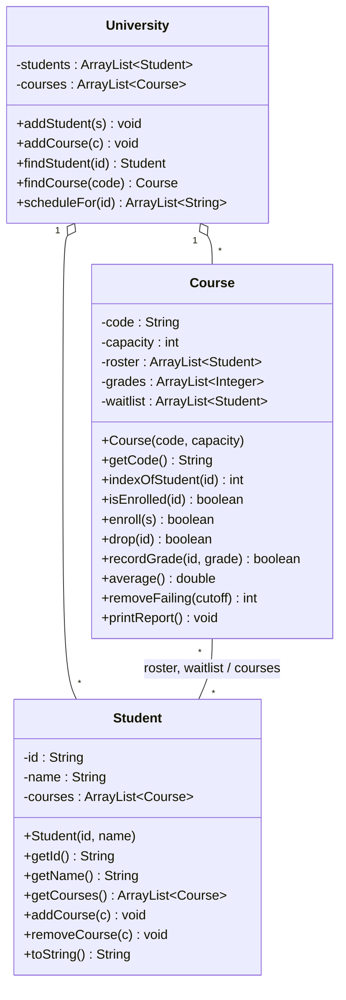

# Lab: Course Registration System

The registrar needs a small program to manage course registration. Courses have a capacity; when a course is full, students join a waitlist. When someone drops, the first waitlisted student takes the seat. Instructors record grades, and the program reports averages.

Implement the system below using `ArrayList` for every collection.

## Design



`grades` is parallel to `roster`: `grades.get(i)` is the grade of `roster.get(i)`, and `null` means no grade yet.

The `Course`–`Student` link is two-way: a student is on a course's roster **if and only if** that course is in the student's `courses`. Waitlisted students do not count as enrolled.

## Requirements

**Student**
- `getCourses()`: the courses the student is currently enrolled in.
- `addCourse(c)` / `removeCourse(c)`: update the student's side of the link. `addCourse` ignores duplicates.
- `toString()` returns `name (id)`, e.g. `Aisha (S1)`.

**Course**
- `indexOfStudent(id)`: roster index of the student with that id, or `-1`.
- `isEnrolled(id)`: whether the student is on the roster.
- `enroll(s)`: returns `true` only if `s` was added to the roster.
  - Already enrolled or waitlisted → no change, `false`.
  - Course full → append to waitlist, `false`.
  - Otherwise → add to roster with no grade.
- `drop(id)`: returns `false` if not enrolled. Otherwise removes the student and their grade, and if the waitlist is non-empty, moves its first student onto the roster.
- `recordGrade(id, grade)`: returns `false` if not enrolled.
- `average()`: mean of recorded grades, ignoring ungraded students; `0.0` if none.
- `removeFailing(cutoff)`: removes every graded student below `cutoff`; returns how many were removed. Does **not** promote from the waitlist.
- `printReport()`: prints in the format shown below.
- Every method that changes the roster must keep the student's `courses` in sync.

**University**
- `findStudent(id)` / `findCourse(code)`: the match, or `null`.
- `scheduleFor(id)`: codes of the student's courses, in the order they were enrolled; empty if the student doesn't exist. Use the student's `courses`, not a search over all courses.

## Test

Use this `main` to check your work:

```java
public class Main {
    public static void main(String[] args) {
        University u = new University();
        u.addStudent(new Student("S1", "Aisha"));
        u.addStudent(new Student("S2", "Mateo"));
        u.addStudent(new Student("S3", "Priya"));
        u.addStudent(new Student("S4", "Kwame"));
        u.addStudent(new Student("S5", "Hiroshi"));
        u.addCourse(new Course("CS130", 3));
        u.addCourse(new Course("MATH151", 30));

        Course cs = u.findCourse("CS130");
        Course math = u.findCourse("MATH151");

        System.out.println("--- Enroll ---");
        for (String id : new String[]{"S1", "S2", "S3", "S4", "S5"}) {
            System.out.println("enroll " + id + ": " + cs.enroll(u.findStudent(id)));
        }
        System.out.println("enroll S1 again: " + cs.enroll(u.findStudent("S1")));
        cs.printReport();

        System.out.println("--- Drop ---");
        System.out.println("drop S2: " + cs.drop("S2"));
        System.out.println("drop S9: " + cs.drop("S9"));
        cs.printReport();

        System.out.println("--- Grades ---");
        cs.recordGrade("S1", 92);
        cs.recordGrade("S3", 55);
        cs.recordGrade("S4", 58);
        cs.printReport();

        System.out.println("--- Remove failing (< 60) ---");
        System.out.println("removed: " + cs.removeFailing(60));
        cs.printReport();

        System.out.println("--- Schedules ---");
        math.enroll(u.findStudent("S1"));
        math.enroll(u.findStudent("S3"));
        System.out.println("S1: " + u.scheduleFor("S1"));
        System.out.println("S3: " + u.scheduleFor("S3"));
        System.out.println("S4: " + u.scheduleFor("S4"));
        System.out.println("S5: " + u.scheduleFor("S5"));
        System.out.println("S9: " + u.scheduleFor("S9"));
    }
}
```

Expected output:

```
--- Enroll ---
enroll S1: true
enroll S2: true
enroll S3: true
enroll S4: false
enroll S5: false
enroll S1 again: false
CS130 (3/3)
  Aisha (S1)  grade: --
  Mateo (S2)  grade: --
  Priya (S3)  grade: --
  waitlist: [Kwame (S4), Hiroshi (S5)]
  average: 0.0
--- Drop ---
drop S2: true
drop S9: false
CS130 (3/3)
  Aisha (S1)  grade: --
  Priya (S3)  grade: --
  Kwame (S4)  grade: --
  waitlist: [Hiroshi (S5)]
  average: 0.0
--- Grades ---
CS130 (3/3)
  Aisha (S1)  grade: 92
  Priya (S3)  grade: 55
  Kwame (S4)  grade: 58
  waitlist: [Hiroshi (S5)]
  average: 68.3
--- Remove failing (< 60) ---
removed: 2
CS130 (1/3)
  Aisha (S1)  grade: 92
  waitlist: [Hiroshi (S5)]
  average: 92.0
--- Schedules ---
S1: [CS130, MATH151]
S3: [MATH151]
S4: []
S5: []
S9: []
```

## Discussion

1. Every collection in this lab is an `ArrayList`. Which would you change to a different collection, and why?