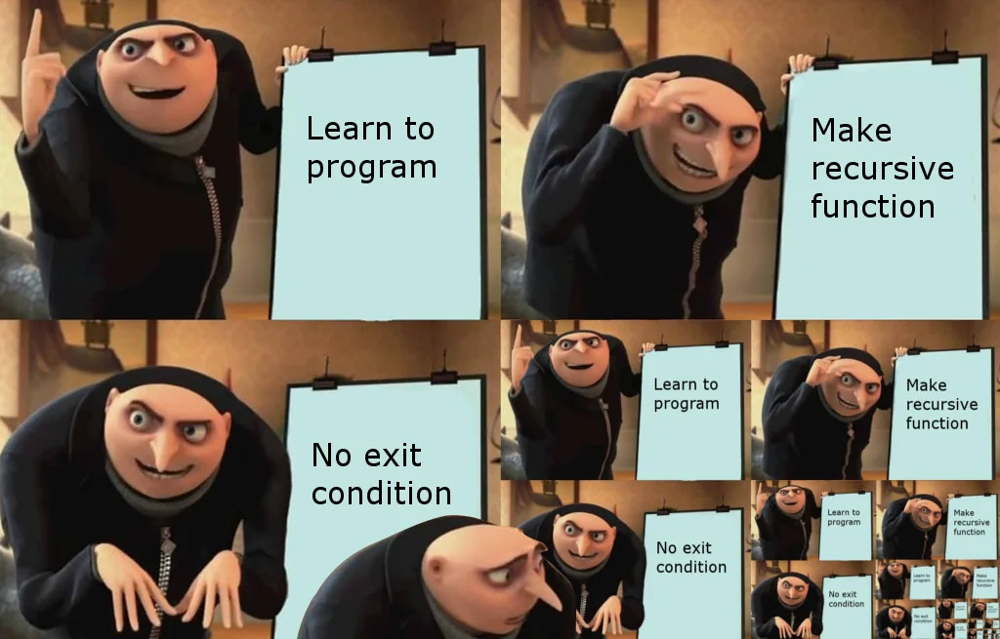
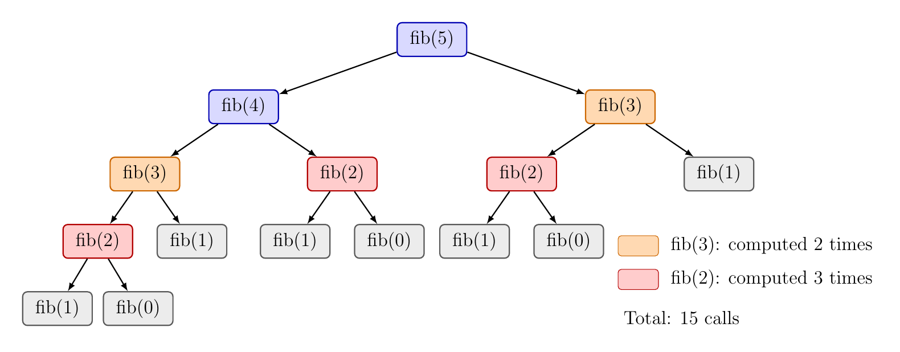
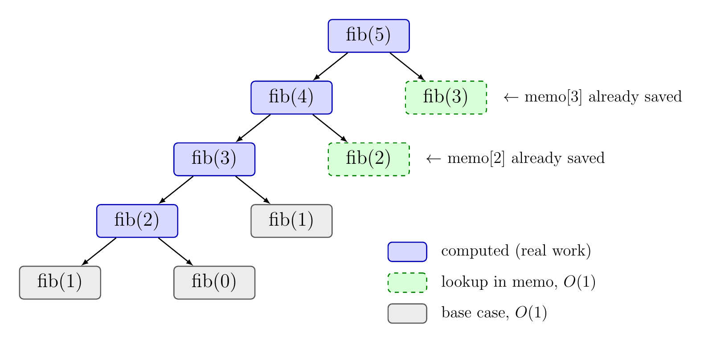

::: {style="background-image: url('images/recursion-img.jpg'); background-size: cover; padding: 1em;"}


:::

## What is recursion?

[Can we google this?](www.google.com)


---


**Recursion** is when a method solves a problem by calling **itself** on a **smaller** version of the same problem.

[Recursion in real life](https://abetterscientist.wordpress.com/wp-content/uploads/2018/10/recursion.jpg)

## Base case and recursive case

**Base case(s)**

- Values of the input for which we make **no** recursive calls.
- There must be at least one base case.
- Every chain of recursive calls must eventually reach a base case.

**Recursive calls**

- Calls to the current method.
- Each recursive call must make **progress** toward a base case.

# Factorial

5! = 5 × 4 × 3 × 2 × 1 = 120

Notice that 5! = 5 × **4!**, so factorial can be defined using a smaller factorial.

```
factorial(n):
    if n == 0:
        return 1
    else:
        return n * factorial(n - 1)
```

- **Base case:** when `n == 0`, return 1 with no recursive call.
- **Recursive case:** call `factorial` on the smaller input `n - 1`, and multiply the result by `n`.

## The call stack

| Call | Waits for | Returns |
|------|-----------|---------|
| factorial(5) | 5 × factorial(4) | 120 |
| factorial(4) | 4 × factorial(3) | 24 |
| factorial(3) | 3 × factorial(2) | 6 |
| factorial(2) | 2 × factorial(1) | 2 |
| factorial(1) | 1 × factorial(0) | 1 |
| factorial(0) | base case | 1 |

- Calls **pile up** on the stack going down.
- Answers **return** going back up, read from the bottom of the table to the top.

## Activity: Expand factorial(4)

On paper, expand `factorial(4)`.

- How many calls are made in total?


## Factorial in Java

```java
public static long factorial(int n) {
    if (n == 0) {
        return 1;                       // base case
    } else {
        return n * factorial(n - 1);    // recursive case
    }
}
```

Why `long` instead of `int`? Factorials grow fast, and `int` overflows after 12!.


## Recursion vs. loop

:::: {.columns}
::: {.column width="48%"}
**Recursive**

```java
long factorial(int n) {
    if (n == 0) {
        return 1;
    }
    return n * factorial(n - 1);
}
```
:::
::: {.column width="4%"}
:::
::: {.column width="48%"}
**Iterative**

```java
long factorial(int n) {
    long result = 1;
    for (int i = 1; i <= n; i++) {
        result = result * i;
    }
    return result;
}
```
:::
::::

Both are correct. Which one is easier to read? Which one matches the math definition?

## What happens if we never reach a base case?

```java
public static long factorial(int n) {
    return n * factorial(n - 1);    // no base case!
}
```

- Every call adds a frame to the call stack.
- The stack never unwinds, so it eventually runs out of space:

```
Exception in thread "main" java.lang.StackOverflowError
```

---




## Common mistakes

What goes wrong in each one?

**Missing base case**

```java
int f(int n) {
    return n + f(n - 1);
}
```

**No progress toward the base case**

```java
int f(int n) {
    if (n == 0) {
        return 0;
    }
    return n + f(n);
}
```

**Forgot to return the result of the recursive call**

```java
int f(int n) {
    if (n == 0) {
        return 0;
    }
    f(n - 1);
    return n;
}
```

# Fibonacci

## Activity: 

0, 1, 1, 2, 3, 5, 8, 13, 21, 34, …

Each number is the sum of the two before it.

- What is the base case?
- What is the recursive case?
- Write `fib(n)`.

::: {.callout-tip collapse="true"}
## Answer

```
fib(n):
    if n < 2:
        return n
    else:
        return fib(n - 1) + fib(n - 2)
```

- **Base case:** `n < 2` (n = 0 or n = 1), return n.
- **Recursive case:** two recursive calls, on `n - 1` and `n - 2`.
:::

## Activity: Count the calls

Draw the call tree for `fib(4)`. How many calls are there?

How many calls for `fib(5)`? For `fib(6)`?

What is the pattern?

## Write the code:

```
calls ← 0

fib(n):
    calls ← calls + 1
    if n < 2:
        return n
    else:
        return fib(n - 1) + fib(n - 2)

for n from 0 to 8:
    calls ← 0
    result ← fib(n)
    print n, result, calls
```

::: {.callout-tip collapse="true"}
## Answer

| n  | fib(n) | calls | ratio                  |
|----|--------|-------|------------------------|
| 0  | 0      | 1     |                        |
| 1  | 1      | 1     | 1/1 = 1.00             |
| 2  | 1      | 3     | 3/1 = 3.00             |
| 3  | 2      | 5     | 5/3 = 1.67             |
| 4  | 3      | 9     | 9/5 = 1.80             |
| 5  | 5      | 15    | 15/9 = 1.67            |
| 6  | 8      | 25    | 25/15 = 1.67           |
| 7  | 13     | 41    | 41/25 = 1.64           |
| 8  | 21     | 67    | 67/41 = 1.63           |
| 9  | 34     | 109   | 109/67 = 1.63          |
| 10 | 55     | 177   | 177/109 = 1.62         |
| 11 | 89     | 287   | 287/177 = 1.62         |
| 12 | 144    | 465   | 465/287 = 1.62         |
| 13 | 233    | 753   | 753/465 = 1.62         |
| 14 | 377    | 1219  | 1219/753 = 1.62        |
| 15 | 610    | 1973  | 1973/1219 = 1.62       |
| 16 | 987    | 3193  | 3193/1973 = 1.62       |
| 17 | 1597   | 5167  | 5167/3193 = 1.62       |
| 18 | 2584   | 8361  | 8361/5167 = 1.62       |
| 19 | 4181   | 13529 | 13529/8361 = 1.62      |
| 20 | 6765   | 21891 | 21891/13529 = 1.62     |

Pattern: calls(n) = 1.62^n (exponential function)
:::


## How fast does it grow?

| | Calls |
|---|---|
| fib(10) | 177 |
| fib(20) | 21,891 |
| fib(30) | 2,692,537 |
| fib(40) | 331,160,281 |


## The fib(5) call tree

{fig-align="center"}

Which calls are repeated?

**Can we make it faster?**

# Memoization

**Memoization** means saving the result of a function call, so the next time the same call comes up, you **look the answer up** instead of computing it again.

How to do it:

1. Create an array `memo` to hold answers (all 0 = nothing computed yet).
2. Before computing, check `memo[n]`. If it already has an answer, return it.
3. Otherwise, compute the answer recursively and save it in `memo[n]`.
4. Return `memo[n]`.

## Fibonacci with memoization

```
fib(n):
    memo ← array of zeros of size n + 1
    return fibMemo(n, memo)

fibMemo(n, memo):
    if n < 2:
        return n
    if memo[n] ≠ 0:
        return memo[n]
    memo[n] ← fibMemo(n - 1, memo) + fibMemo(n - 2, memo)
    return memo[n]
```

The base case is the same as before. The only change: check the array first, and save the answer.

## Activity: Fibonacci with memoization in Java

```
calls ← 0

fib(n):
    memo ← array of zeros of size n + 1
    return fibMemo(n, memo)

fibMemo(n, memo):
    calls ← calls + 1
    if n < 2:
        return n
    if memo[n] ≠ 0:
        return memo[n]
    memo[n] ← fibMemo(n - 1, memo) + fibMemo(n - 2, memo)
    return memo[n]

previousCalls ← 0
for n from 0 to MAX_N:
    calls ← 0
    result ← fib(n)
    print n, result, calls
    if previousCalls > 0:
        print calls / previousCalls
    previousCalls ← calls
```

## The memoized fib(5) call tree

{fig-align="center"}

## Count the calls again

| n  | fib(n) | calls | ratio          |
|----|--------|-------|----------------|
| 0  | 0      | 1     |                |
| 1  | 1      | 1     | 1/1 = 1.00     |
| 2  | 1      | 3     | 3/1 = 3.00     |
| 3  | 2      | 5     | 5/3 = 1.67     |
| 4  | 3      | 7     | 7/5 = 1.40     |
| 5  | 5      | 9     | 9/7 = 1.29     |
| 6  | 8      | 11    | 11/9 = 1.22    |
| 7  | 13     | 13    | 13/11 = 1.18   |
| 8  | 21     | 15    | 15/13 = 1.15   |
| 9  | 34     | 17    | 17/15 = 1.13   |
| 10 | 55     | 19    | 19/17 = 1.12   |
| 11 | 89     | 21    | 21/19 = 1.11   |
| 12 | 144    | 23    | 23/21 = 1.10   |
| 13 | 233    | 25    | 25/23 = 1.09   |
| 14 | 377    | 27    | 27/25 = 1.08   |
| 15 | 610    | 29    | 29/27 = 1.07   |
| 16 | 987    | 31    | 31/29 = 1.07   |
| 17 | 1597   | 33    | 33/31 = 1.06   |
| 18 | 2584   | 35    | 35/33 = 1.06   |
| 19 | 4181   | 37    | 37/35 = 1.06   |
| 20 | 6765   | 39    | 39/37 = 1.05   |

 - Each value is computed **only once**.
 - It goes down to **1**. It is **Linear**.


# Activity 1

[LeetCode 70: Climbing Stairs](https://leetcode.com/problems/climbing-stairs/)

**Can you find the recursive pattern?**


# Activity 2

[LeetCode 1137. N-th Tribonacci Number](https://leetcode.com/problems/n-th-tribonacci-number/)


**Can you find the recursive pattern?**


# Another Recursion

## Activity: Guessing game

1. Pair up with the TA.
2. One of you secretly picks a number from 1 to 10 and writes it down.
3. The other guesses the number.
4. Your partner can only say **"higher,"** **"lower,"** or **"correct."**
5. Count your guesses.

How fast is your strategy?

## Linear search in sorted input

| 1 | 2 | 3 | 4 | 5 | 6 | 7 | 8 | 9 | 10 |
|---|---|---|---|---|---|---|---|---|----|

- Check each element one by one, from the first to the last.
- Stop when the key is found, or when you reach the end.
- Worst case: the key is last or missing, so we check **all n** elements.

**Can we do better?** What if we use the fact that the array is sorted?

## Binary search

1. If only one element is left, it is the key. Stop.
2. Find the middle element.
3. If key ≤ middle, binary search the left half (with middle).
4. Otherwise, binary search the right half.

- **Base case:** one element left.
- **Recursive case:** binary search half of the array.


---


{fig-align="center"}


---


[Visualize it:](https://coddy.tech/visualize/searching/binary-search)


## Trace

Key = 9

| index | 0 | 1 | 2 | 3 | 4 | 5 | 6 | 7 | 8 | 9 |
|-------|---|---|---|---|---|---|---|---|---|---|
| data  | 1 | 2 | 3 | 4 | 5 | 6 | 7 | 8 | 9 | 10 |

| low | high | mid | A[mid] | Next |
|-----|------|-----|--------|------|
| 0 | 9 | 4 | 5 | 9 > 5, search right |
| 5 | 9 | 7 | 8 | 9 > 8, search right |
| 8 | 9 | 8 | 9 | 9 ≤ 9, search left (with middle) |
| 8 | 8 | | | one element left: found! |

## Pseudocode

```
Algorithm binarySearch(A, T, L, R)
   Input  a sorted array A
          a target value T to look up
          the leftmost index L
          the rightmost index R
   Output the index of T in A, or -1 if T is not found

   if L > R then
      return -1
   m ← L + floor((R - L) / 2)
   if A[m] < T then
      return binarySearch(A, T, m + 1, R)
   else if A[m] > T then
      return binarySearch(A, T, L, m - 1)
   else
      return m
```

First call: `binarySearch(A, key, 0, length(A) - 1)`

## Binary search in Java

```java
/**
 * Searches the sorted array A for T using recursive binary search.
 *
 * @param A the sorted array to search
 * @param T the target value
 * @param L the leftmost index of the range being searched
 * @param R the rightmost index of the range being searched
 * @return the index of T in A, or -1 if T is not found
 */
public static int binarySearch(int[] A, int T, int L, int R) {
    if (L > R) {
        return -1;                                  // not found
    }
    int m = L + (R - L) / 2;
    if (A[m] < T) {
        return binarySearch(A, T, m + 1, R);        // search right half
    } else if (A[m] > T) {
        return binarySearch(A, T, L, m - 1);        // search left half
    } else {
        return m;                                   // found
    }
}
```


## Activity:

5^4^ = 5 × 5 × 5 × 5 = 625

Notice that 5^4^ = 5 × **5^3^**.

- What is the base case?
- What is the recursive case?
- Write `power(x, n)` recursively.

::: {.callout-tip collapse="true"}
## Answer

```
power(x, n):
    if n == 0:
        return 1
    else:
        return x * power(x, n - 1)
```
:::

## Challenge: Can you make it faster?

5^17^ = 5 × 5 × 5 × 5 × 5 × 5 × 5 × 5 × 5 × 5 × 5 × 5 × 5 × 5 × 5 × 5 × 5

How many multiplications?

**LeetCode 50: Pow(x, n):** <https://leetcode.com/problems/powx-n/description/>

Hint: 5^16^ = 5^8^ × 5^8^

- If you already know 5^8^, do you need to compute it twice?
- How many multiplications does 5^17^ need now?

# Summary: Writing a Recursive Method

1. **Base case:** what is the smallest input you can answer directly?
2. **Recursive case:** how can you solve the problem using a **smaller** version of itself?
3. **Progress:** does every call move closer to the base case?
4. **Return:** do you return the result of the recursive call?
5. **Repeated work?** If the same calls happen again and again, use **memoization**.
